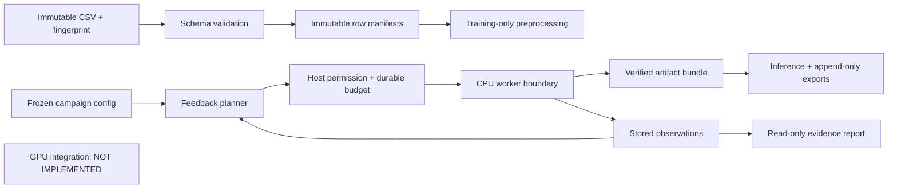

# Execution architecture and boundaries

The developer PC is for implementation and no-training verification. The friend's machine is the sole future training authority. GPU integration is deliberately deferred.

## Contracts

- Recipe: immutable family, CPU backend, feature version, seed, threads and validated model parameters; canonical content hash identifies it.
- Dataset: validated feature table, optional binary target, stable unique customer IDs and source fingerprint. Identifiers/target never enter predictors.
- Split manifest: source fingerprint plus disjoint Train/Search/Audit memberships and one development-only paired split. No seed shopping or file overwrite.
- Observation: one numbered attempt, recipe, phase, actual scores/timings/tree count and persisted artifact reference. Search/probe/audit metrics are never pooled.
- Ledger: SQLite single writer, atomic irreversible reservations, explicit phases, one active worker, 15 global attempts, two reserved terminal fits, and immutable final audit identities.
- CPU worker: training permission must be explicitly enabled for the configured host before reservation or estimator construction. Defaults refuse training everywhere.
- Finalization: verify cached fallback, development-trained audit proxy and full-data model; choose artifacts by technical success before releasing audit metrics.
- Inference/reporting: consume saved artifacts/results only. Later exports append input/contract/output hashes to the locked model identity.

## Current execution ruling

Tests may fit preprocessing on synthetic rows, score supplied predictions and exercise fake workers. They may not fit Logistic Regression, CatBoost, LightGBM or any other predictive model. Test infrastructure forbids real estimator fitting. No GPU selection, device probing, CUDA setup or GPU adapter is part of this pass.

CPU adapters can be implemented and inspected without executing their fitting path. Real fitting and native-model artifact verification remain unverified until run on the authorized training machine. An absent trained artifact is an error, never an invitation to train during inference.

## Data and submission provenance

The downloaded IBM table is public reference data. The official portal split and output contract are unknown. Provisional functional outputs are labelled accordingly. Do not import public labels for official hidden-test customers. Changing input files cannot silently reset campaign accounting.
