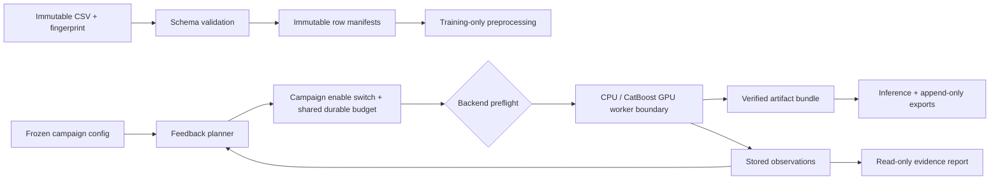

# Execution architecture and boundaries

Training can run on any machine where the project and required packages are available. The dashboard binds to loopback by default. CatBoost GPU integration is implemented, but native GPU execution remains unverified.

## Contracts

- Recipe: immutable family, CPU/CatBoost-GPU backend, feature version, seed, threads and validated model parameters; canonical content hash identifies it.
- Dataset: validated feature table, optional binary target, stable unique customer IDs and source fingerprint. Identifiers/target never enter predictors.
- Split manifest: source fingerprint plus disjoint Train/Search/Audit memberships and one development-only paired split. No seed shopping or file overwrite.
- Observation: one numbered attempt, recipe, phase, actual scores/timings/tree count and persisted artifact reference. Search/probe/audit metrics are never pooled.
- Ledger: SQLite single writer, atomic irreversible reservations, campaign-scoped phases and Audit locks, one active worker, 15 attempts shared across all rounds, and immutable Audit identities within each round.
- Worker: the campaign configuration controls whether training is enabled; no hostname allowlist is used. Dashboard runs require a local button click and confirmation, and CLI runs require `--execute`. GPU mode additionally requires the dataset/package/driver/device/free-VRAM preflight and never silently retries on CPU.
- Finalization: verify cached fallback, development-trained audit proxy and full-data model; choose artifacts by technical success before releasing audit metrics.
- Inference/reporting: consume saved artifacts/results only. Later exports append input/contract/output hashes to the locked model identity.

## Current execution ruling

Tests may fit preprocessing on synthetic rows, score supplied predictions and exercise fake workers. They may not fit Logistic Regression, CatBoost, LightGBM or any other predictive model. GPU tests use mocked constructors and hardware-query results; they do not probe a device or train.

CPU and CatBoost GPU adapters can be inspected without executing their fitting paths. Real fitting, native GPU execution and native-model artifact verification remain unverified. GPU selection is frozen in campaign/runtime identity and confined to CatBoost; LR and LightGBM remain CPU. An absent trained artifact is an error, never an invitation to train during inference.

## Data and submission provenance

The downloaded IBM table is public reference data. The official portal split and output contract are unknown. Provisional functional outputs are labelled accordingly. Do not import public labels for official hidden-test customers. Changing input files cannot silently reset campaign accounting.
